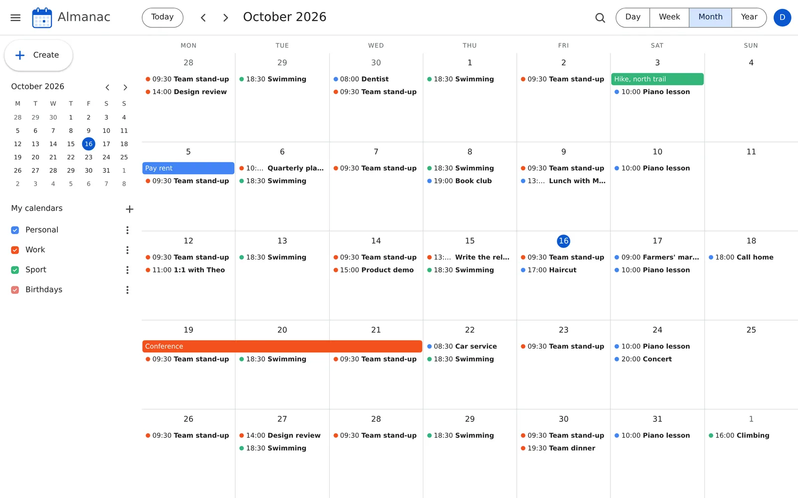
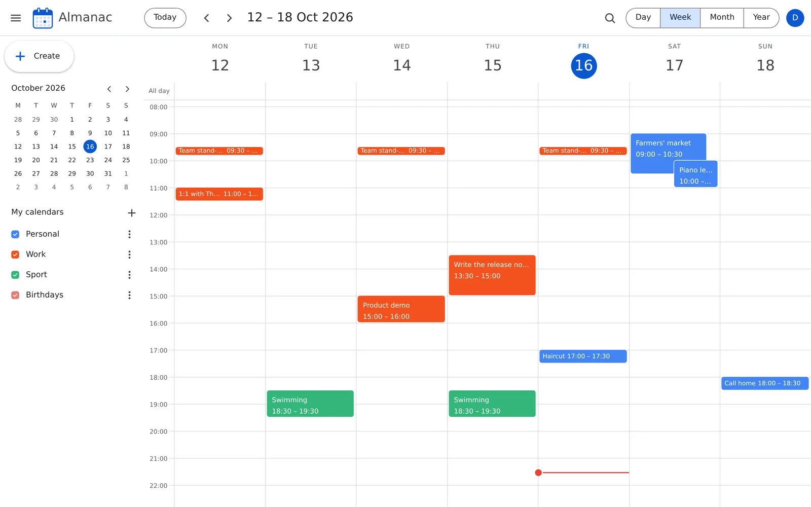
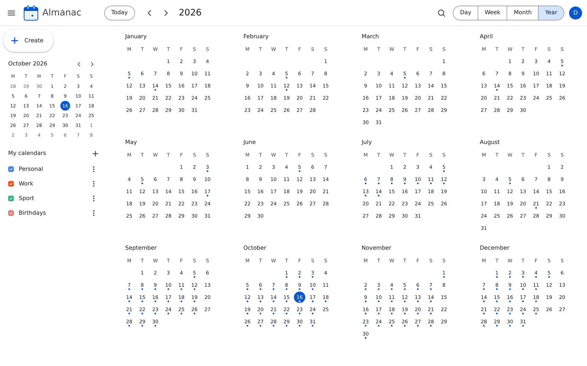
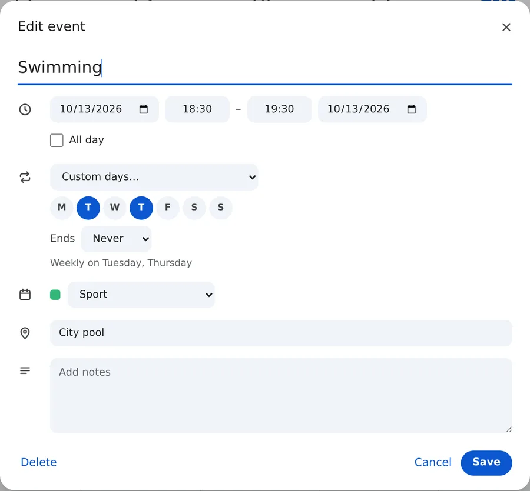
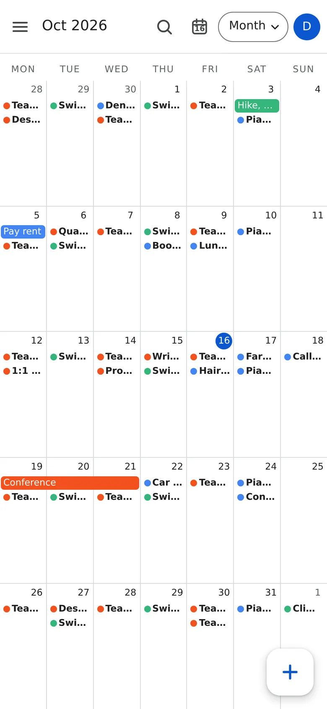
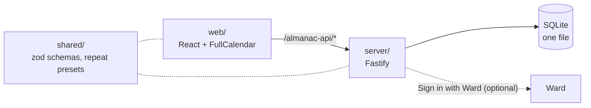

# Almanac

A self-hosted calendar that works like Google Calendar, for one person or a few people who each keep their own private calendars.

<p align="center">
  
</p>

**Status:** Personal project. Version 1 is built and reviewed and runs locally. It is not deployed yet.

## What it does

- Shows your schedule by day, week, month or year. Month opens first, weeks start on Monday and times use a 24-hour clock.
- Creates an event when you click or drag across empty time. Drag an event to move it, or drag its bottom edge to change its length.
- Repeats events daily, every weekday, weekly on the days you pick, monthly or yearly. Changing one occurrence asks whether the change is for this event, this and following, or all events.
- Keeps events in named, coloured calendars you can show or hide one at a time, and finds them by title, location or notes.
- Shows every time in one display time zone you choose (Europe/Bucharest to start), whatever zone the device is in.
- Fits a phone screen and can be added to its home screen. The keyboard shortcuts are Google's: `c`, `t`, `d` `w` `m` `y`, the arrow keys and `/`.

Google Calendar does all of this. Almanac keeps the layout and the habits but runs on your own server, and each user sees only their own calendars. There is no sharing and no sign-up page. The only accounts are the ones you create with the seed or let in through Ward. Version 1 has no import, reminders, guests, attachments, dark mode or offline use, so you type every event in. Reminders are the first planned addition.

## Screenshots

| The week, with a line at the current time | The year, with a dot on each day that has events |
|---|---|
|  |  |

| Editing a repeating event | On a phone |
|---|---|
|  |  |

The screens show a made-up `demo` account. How each image was made: [docs/images/shots.md](docs/images/shots.md).

## How it works

Three npm workspaces. `shared` holds the zod schemas for every route, the repeat presets and the date helpers, and both other parts import it. `server` is a Fastify API on SQLite. It stores a repeating event once, as a series with an RRULE, and expands it into occurrences with rrule-temporal for whatever range a view asks for. `web` is the React app. FullCalendar v7 draws the day, week and month views, and the year view is Almanac's own. You sign in with a local account, or with [Ward](https://github.com/gandolh/ward-auth), the sign-in service the owner's other apps share.



More in [docs/architecture.md](docs/architecture.md).

## Run it locally

Requires Node 24 or later and npm.

```bash
npm install
cp .env.example .env              # optional, the defaults work
npm run seed -w @almanac/server   # asks for a username and password
npm run dev
```

Then open <http://localhost:5177/almanac/> and sign in with the account the seed created. Env vars, tests, the Ward button and a fix for `ENOSPC` errors: [docs/getting-started.md](docs/getting-started.md).

## Project layout

| Path | What lives there |
|---|---|
| `shared/` | zod schemas for every route, the repeat presets, date helpers |
| `server/` | Fastify API, SQLite store, repeat expansion, the vendored Ward auth library |
| `web/` | React app, served under `/almanac/` |
| `infrastructure/` | Dockerfile and compose file for the API container |
| `corpus/` | Project wiki, decisions and the numbered briefs |
| `docs/` | Setup, architecture, the owner's deploy steps and the images here |

## Docs

- [docs/](docs/README.md): setup, architecture, the owner's deploy steps, and the images used here
- [corpus/](corpus/index.md): the project wiki, with features, decisions, status and the briefs

## License

No license yet; all rights reserved.
