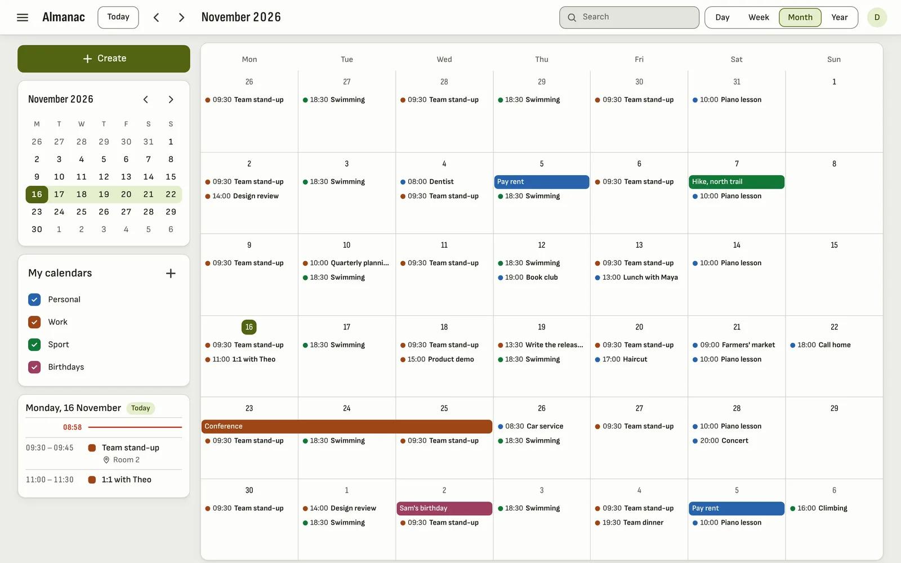
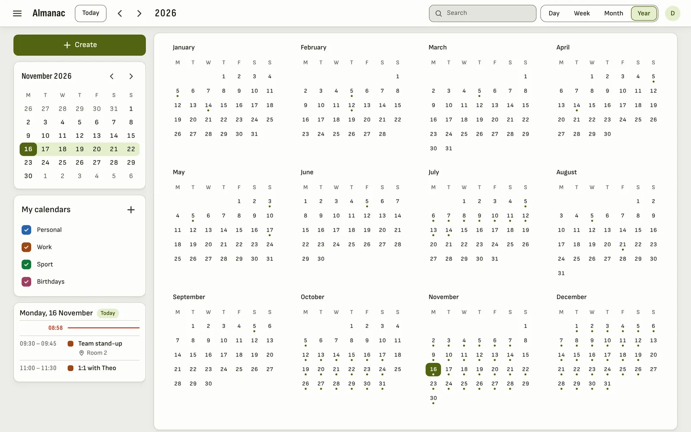
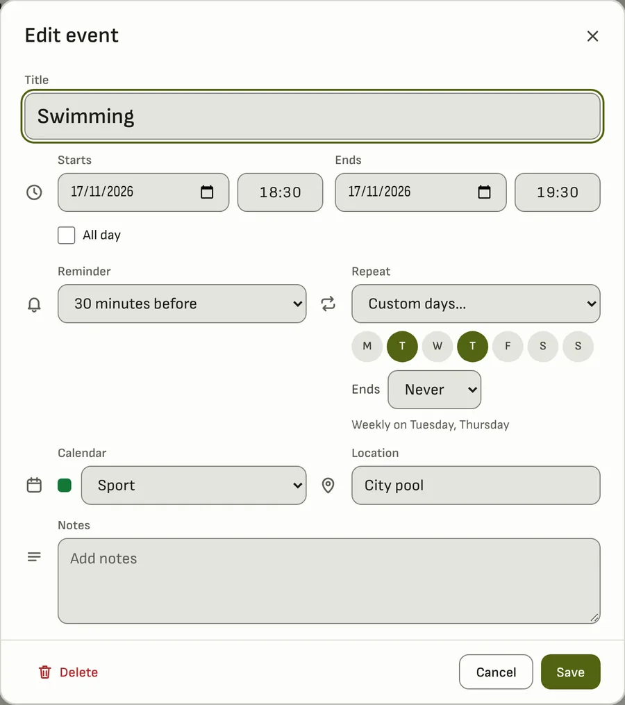
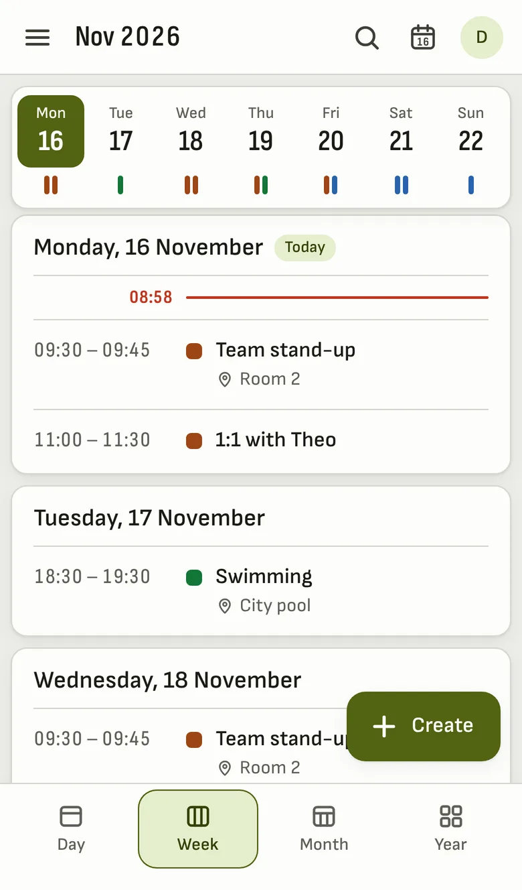
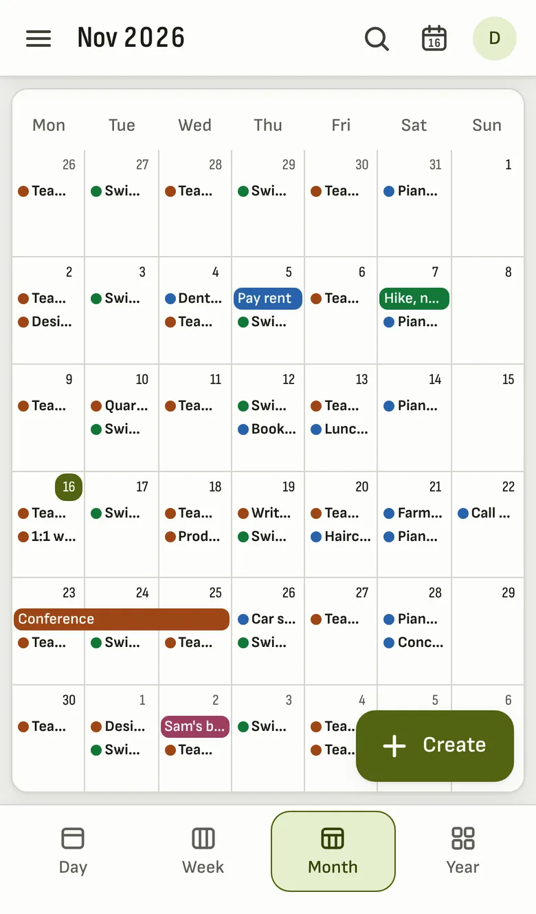
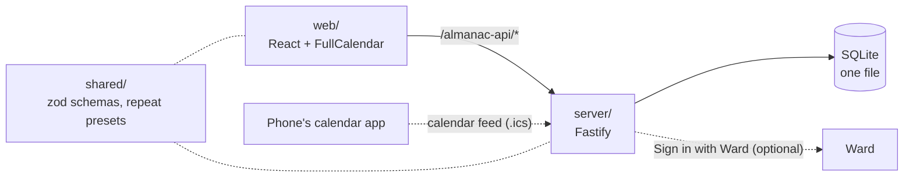

# Almanac

A self-hosted calendar that works like Google Calendar, for one person or a few people who each keep their own private calendars.

<p align="center">
  
</p>

**Status:** Personal project. Version 1, notifications, the redesign (2026-11-13) and the calendar feed are built and run locally. Nothing is deployed yet, so no real phone has shown a notification or read the feed.

## What it does

- Shows your schedule by day, week, month or year. Month opens first, weeks start on Monday and times use a 24-hour clock. The keyboard shortcuts are Google's: `c`, `t`, `d` `w` `m` `y`, the arrow keys and `/`.
- Creates an event when you click or drag across empty time. Drag an event to move it, or drag its bottom edge to change its length.
- Repeats events daily, every weekday, weekly on the days you pick, monthly or yearly. Changing one occurrence asks whether the change is for this event, this and following, or all events.
- Keeps events in named, coloured calendars you can show or hide one at a time, and finds them by title, location or notes.
- Shows every time in one display time zone you choose (Europe/Bucharest to start), whatever zone the device is in.
- Reminds you before an event with a push notification on your phone or desktop browser, from 1 day to the start time, once you turn Notifications on in the account menu.
- Shows your events in your phone's own calendar app through a private, read-only link (with ICSx⁵ on Android), once you turn on Calendar feed in the account menu.
- Fits a phone. Week becomes a strip of seven days over a list of that week's events, a bar at the bottom switches views, and the app can go on the home screen. Theme… in the account menu picks light, dark or the device's setting.

Google Calendar does all of this. Almanac keeps Google's layout and habits in a look of its own (olive greys, raised cards, one moss-green accent), runs on your own server, and shows each user only their own calendars. There is no sharing and no sign-up page. The only accounts are the ones you create with the seed or let in through Ward. It has no import, guests, attachments or offline use, so you type every event in. Reminders need the server's VAPID keys, made with one command.

## Screenshots

| The week, with the time now marked in the grid and in today's list | The year, with a dot under each day that has events |
|---|---|
|  |  |

| Editing a repeating event, with a reminder | On a phone: the week and the month |
|---|---|
|  |   |

The screens show a made-up `demo` account. How each image was made: [docs/images/shots.md](docs/images/shots.md).

## How it works

Three npm workspaces. `shared` holds the zod schemas for every route, the repeat presets and the date helpers, and both other parts import it. `server` is a Fastify API on SQLite. It stores a repeating event once, as a series with an RRULE, and expands it into occurrences with rrule-temporal for whatever range a view asks for. `web` is the React app, styled with Tailwind. FullCalendar v7 draws the day, week and month views; the year view and the phone's week list are Almanac's own. You sign in with a local account, or with Ward, the sign-in service the owner's other apps share. A phone's calendar app reads the calendar feed without signing in, because the secret is in the link.



More in [docs/architecture.md](docs/architecture.md). The look and its tokens are in [web/DESIGN.md](web/DESIGN.md).

## Run it locally

Requires Node 24 or later and npm.

```bash
npm ci
cp .env.example .env              # optional, the defaults work
npm run seed -w @almanac/server   # asks for a username and password
npm run dev
```

Then open <http://localhost:5177/almanac/> and sign in with the account the seed created. Env vars, tests, other ports, the Ward button and a fix for `ENOSPC` errors: [docs/getting-started.md](docs/getting-started.md).

## Project layout

| Path | What lives there |
|---|---|
| `shared/` | zod schemas for every route, the repeat presets, date helpers |
| `server/` | Fastify API grouped by feature, SQLite store, repeat expansion, the vendored Ward auth library |
| `web/` | React app, served under `/almanac/`, with its design record and Playwright specs |
| `scripts/` | The contrast check over both themes' colours, the changed-files lint behind `npm run check:fast`, and the exceptions the convention checks accept |
| `vendor/` | A generated copy of the shared house style: ESLint, Prettier, knip and TypeScript configs and the convention checkers |
| `infrastructure/` | Dockerfile and compose file for the API container |
| `corpus/` | Project wiki, decisions and the numbered briefs |
| `docs/` | Setup, architecture, the owner's deploy steps and the images here |

## Docs

- [docs/](docs/README.md): setup, architecture, the owner's deploy steps, and the images used here
- [web/DESIGN.md](web/DESIGN.md): the look, with the colours, type, shapes and layout of both themes
- [corpus/](corpus/index.md): the project wiki, with features, decisions, status and the briefs

## License

No license yet; all rights reserved.
