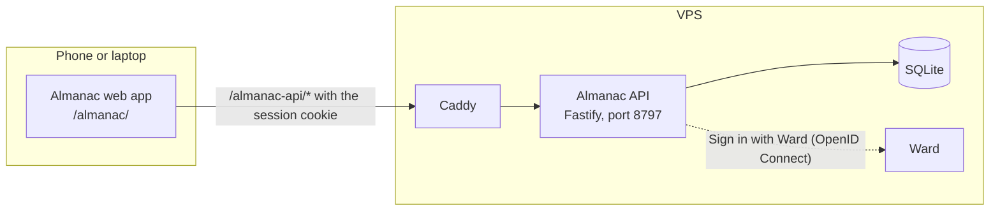

# Architecture

Almanac is three npm workspaces. `shared` holds the zod schemas for every
route, the repeat presets and their RRULEs, and the date helpers; the other
two import it. `server` is a Fastify API on one SQLite file (better-sqlite3).
Its store is the only code that runs SQL, apart from the vendored Ward auth
library, and every query filters by the signed-in user. `web` is the React
app, served under `/almanac/`. FullCalendar v7 draws the day, week and month
views and loads as its own chunk; the year view and search are Almanac's own.
In production Caddy serves the web app and forwards `/almanac-api/*` to the
API container with the prefix stripped, so the server's own routes are
`/api/*` and `/auth/*`. In development Vite does the same.

## Loading a view

1. The web app works out the range on screen (a week, a month grid) in the
   user's display time zone and asks `GET /api/occurrences?from&to`.
2. The server reads the user's one-off events in range and every series that
   could reach into it.
3. It expands each series with rrule-temporal in the zone the series was
   created in, drops its deleted dates and puts its changed occurrences in
   their place.
4. The answer is a flat list of concrete occurrences, each with its series id
   and original start when it belongs to one. Instants travel as UTC.
5. FullCalendar shifts them into the display time zone and draws them. It
   never sees a repeat rule.

## Changing a repeating event

Moving, resizing, editing or deleting an occurrence of a series asks for the
edit scope. "This event" writes an exception (or a deleted date). "This and
following" ends the old series just before this occurrence and starts a new
one from it. "All events" changes the series row. The details, and what
happens to existing exceptions, are in
[corpus/wiki/recurrence.md](../corpus/wiki/recurrence.md).

## Read more

- [corpus/wiki/architecture.md](../corpus/wiki/architecture.md): the routes,
  request paths, ports, data and secrets
- [corpus/wiki/recurrence.md](../corpus/wiki/recurrence.md): presets,
  storage, expansion and edit scopes
- [corpus/wiki/data-model.md](../corpus/wiki/data-model.md): the tables
- [corpus/wiki/decisions.md](../corpus/wiki/decisions.md): what was decided
  and what was rejected
- Code: [shared/src/repeat.ts](../shared/src/repeat.ts),
  [server/src/recurrence/](../server/src/recurrence/),
  [server/src/routes/](../server/src/routes/),
  [web/src/calendar/](../web/src/calendar/)
